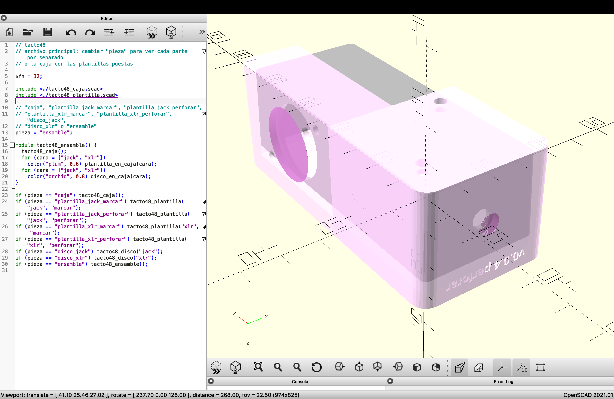

# Semana-13

## Resumen de días, temas y horas

| Fecha      | Día      | Temas                                                | Lugar     | Horas día / hora semana |
| :--------- | :------- | :--------------------------------------------------- | :-------- | :---------------------- |
| 2026-10-19 | Lunes    | Fabricación, Modelado 3D, OpenSCAD                   | LID, Pañol | 008 / 008               |
| 2026-10-20 | Martes   | Modelado 3D                                          | LID       | 005 / 013               |
| 2026-10-22 | Jueves   | Modelado 3D, Fabricación digital                     | LID       | 003 / 016               |
| 2026-10-23 | Viernes  | Fabricación                                          | LID       | 004 / 020               |

## Tacto 48

### Cambios en las guías

Hoy seguí ajustando las guías para perforar la caja de aluminio 1590A, en el repositorio de **[Tacto 48](https://github.com/Bernardita-Jesus/tacto48/tree/main/modelado-caja)**, y llegué a la versión **v0.0.4**:

- **Perforaciones abiertas:** Dejé abiertas todas las perforaciones de las guías, con holgura para que pase la broca: el jack a 6,8 mm, los tornillos del XLR a 4 mm y el círculo del XLR a su diámetro final de 24,2 mm.

- **Disco del XLR:** Como el círculo del XLR queda abierto, diseñé una pieza aparte, un disco de 24 mm que calza dentro del círculo con 0,1 mm de tolerancia por lado. Tiene un agujero de 2,5 mm al centro para marcar con punzón y se saca después de marcar.

- **Disco del jack:** Hice lo mismo para el jack, con un disco de 6,6 mm y un agujero de 2,5 mm al centro.

- **Tolerancia:** Las guías no calzaban bien en la caja, así que subí la tolerancia entre la guía y la caja de 0,2 mm a 0,4 mm por lado. Ahora el hueco mide 39,3 × 31,8 mm para la caja de 38,5 × 31 mm.

En la siguiente foto se pueden ver las guías impresas de las versiones **v0.0.2** y **v0.0.3**, cada una con su disco del XLR. En la v0.0.2, los tornillos del XLR todavía tenían solo la marca chica con el anillo grabado; en la v0.0.3, todas las perforaciones ya quedaron abiertas.

### Perforación de la caja

El proceso de fabricación de las perforaciones terminó convirtiéndose en una manualidad y una artesanía, ya que la broca que escogí no fue la correcta. Perdón por eso, [Aarón](https://github.com/montoyamoraga).

El proceso consistió en fabricar una guía para marcar el centro de las perforaciones con una broca de 2 mm y otra guía para perforar hasta alcanzar el ancho máximo requerido. Para realizar las perforaciones de manera adecuada, sería necesario comprar una broca de corona.

#### Cómo se usan las guías

1. Coloco la guía de perforación inicial en uno de los extremos de la caja.

2. Marco el centro de cada perforación con un punzón, utilizando la guía de perforación inicial como referencia.

3. Perforo los puntos marcados con una broca de 2 mm.

4. Coloco la guía de perforación completa y la utilizo para ampliar las perforaciones hasta alcanzar el ancho máximo requerido.

En la siguiente foto se pueden ver las guías de la versión **v0.0.4**, con su grabado de "marcar" y "perforar", junto a la caja de aluminio ya perforada, la broca escalonada, la prensa y la viruta de aluminio que quedó del proceso.

Con las guías de la versión **v0.0.4** perforé la caja de aluminio. De esto aprendí dos cosas:

- **Broca corona para el XLR:** La perforación grande de la **salida XLR** (24,2 mm) debería hacerse con una **broca corona** (sierra copa) bimetálica para metal, en vez de la broca escalonada.

- **Dremel para la tapa:** Necesito ocupar un **Dremel** para poder desbastar la tapa de la caja.

En la siguiente foto se puede ver el resultado: la caja de aluminio con el conector XLR montado en un extremo, el interior con el XLR y el jack ya instalados, y el jack TS de 3,5 mm en el otro extremo.

Links de brocas corona:

- Sodimac: https://www.sodimac.cl/sodimac-cl/b/broca-copa

- Sierras copa bimetálicas de Bosch: https://www.bosch-professional.com/pa/es/sierras-copa-bim-ecoline-m3-para-adaptadores-estandar-2868316-ocs-ac/

En la siguiente captura se puede ver la **distribución final** de las perforaciones en la caja de aluminio, en la versión **v0.0.4**: el XLR en uno de los extremos, con sus dos tornillos M3 en diagonal; el jack en la parte de abajo; y las dos perforaciones de los tornillos de la PCB.

