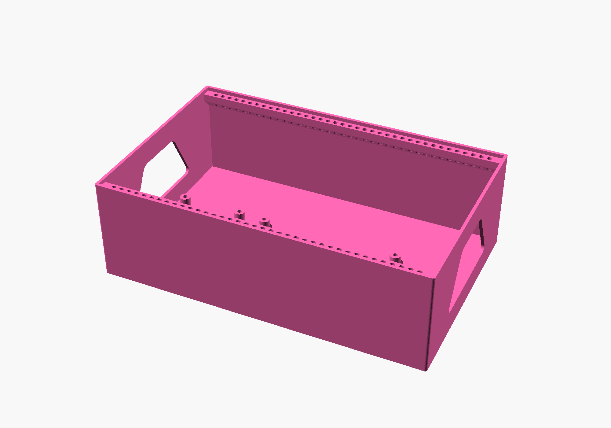
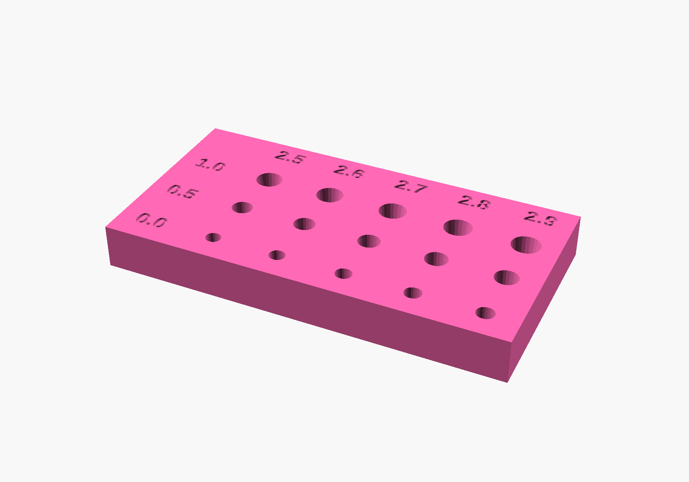
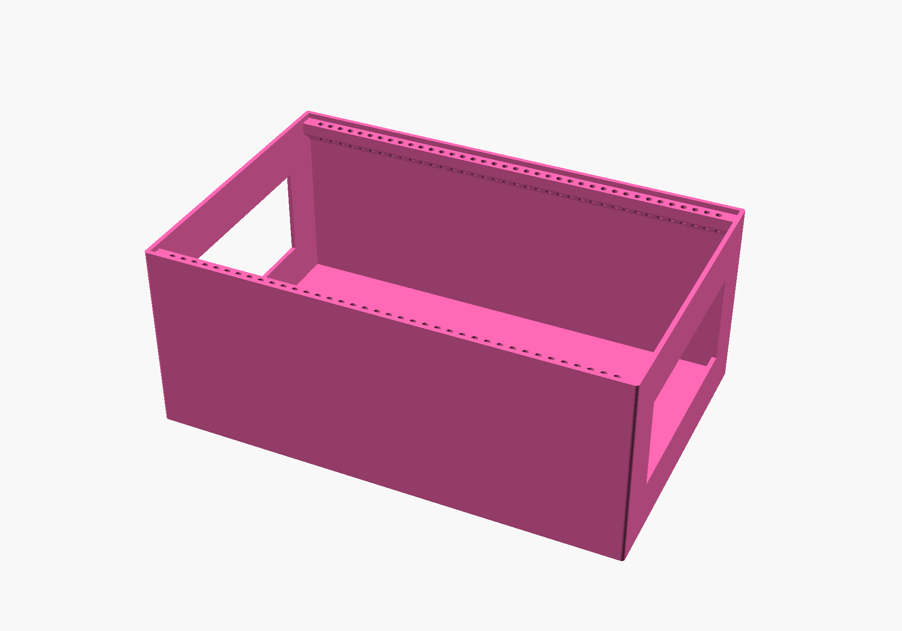
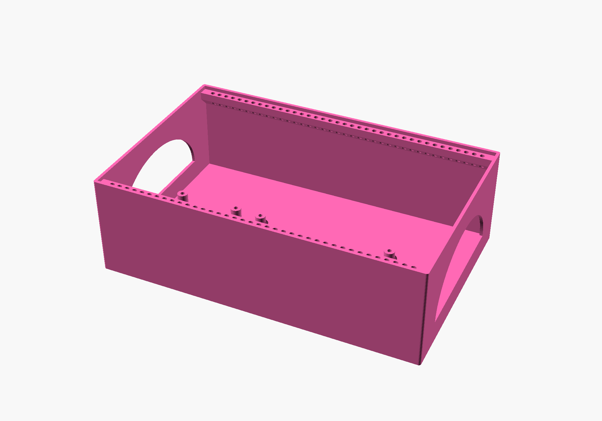
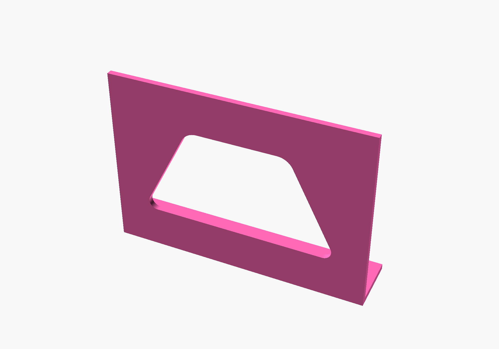

# Semana-17

## Resumen de días, temas y horas

| Fecha      | Día      | Temas                                                | Lugar     | Horas día / hora semana |
| :--------- | :------- | :--------------------------------------------------- | :-------- | :---------------------- |
| 2026-11-16 | Lunes    | OpenSCAD                                             | LID       | 003 / 003               |
| 2026-11-17 | Martes   | Fabricación, Impresión 3D                            | LID, Todotorner | 002 / 005               |
| 2026-11-18 | Miércoles | Informe de práctica                                 | LID, Casa | 003 / 008               |
| 2026-11-22 | Domingo  | Organización general, Informe de práctica            | Casa      | 002 / 010               |

## Correcciones bote

Junto a [Aarón](https://github.com/montoyamoraga) corregimos las **dimensiones**, la **altura** y las **perforaciones** del **bote** de los **Popusintes**, la caja para los módulos **Eurorack**, en el repositorio **[bote](https://github.com/piruetasxyz/bote)**. Todos los cambios quedaron en la versión **v0.1 rev-d**, que fue modelada en **OpenSCAD**.

En la siguiente captura se puede ver un render en **OpenSCAD** del bote v0.1 rev-d: la caja de 40 HP con los rieles de agujeros piloto arriba, los postes en el piso para la fuente y el bus, y los agujeros del bus de poder en las dos paredes laterales.

### Dimensiones y altura

- **Ancho:** La caja mide **40 HP** de ancho, igual que la rev-c.

- **Profundidad:** La **profundidad útil** bajó de 80 mm a **60 mm**. Es suficiente para los módulos que caben en los 4ms pods más profundos, que miden 55 mm.

### Postes para la fuente de poder

En el piso de la caja agregamos **postes** para atornillar, con tornillos M3 × 6 mm, la fuente de poder **chufe v0 rev-b**, con postes de 11 mm y el jack hacia el agujero de la pared izquierda, y a su derecha el bus **chufebu v0 rev-b**, con postes de 6 mm.

### Agujeros de los tornillos

Los **agujeros piloto** de los rieles y de los postes subieron de 2,6 mm a **2,9 mm**, sin **chaflán de entrada**, para poder **atornillar los paneles con los dedos**. El diámetro lo elegimos imprimiendo una prueba de agujeros, **prueba_agujeros.scad**.

En la siguiente captura se puede ver un render de la prueba de agujeros: una placa donde cada columna es un diámetro de agujero, de 2,5 a 2,9 mm, y cada fila un chaflán de entrada distinto, de 0, 0,5 y 1 mm, con las medidas grabadas.

### Agujeros del bus de poder

Los agujeros del **bus de poder** están en las dos paredes laterales y dejan 15 mm de pared arriba y abajo. Yo los rediseñé para que se impriman mejor **sin soportes**.

1. **Perforación cuadrada:** En las versiones anteriores del bote, el agujero del bus de poder era un **rectángulo**. En la rev-a medía 90 × 20 mm y estaba solo en la pared izquierda; en la rev-c pasó a estar en las dos paredes laterales y subió a 90 × 40 mm. Al imprimir la caja con la base sobre la cama, el lado de arriba del rectángulo quedaba como un **puente recto** largo, sin nada que lo sostuviera.

En la siguiente captura se puede ver un render de la caja rev-c, con la perforación cuadrada del bus de poder en las dos paredes laterales.

2. **Media elipse:** En la rev-d, el agujero pasó a ser una **media elipse** de 90 mm de base. La parte de arriba quedaba en **voladizo**, pero subía de a poco y ya no era un puente recto.

En la siguiente captura se puede ver un render de la caja rev-d antes de mi cambio, con los agujeros del bus de poder en forma de media elipse. Se puede comparar con la primera captura de esta sección, donde ya están los trapecios.

3. **Trapecio a 45 grados:** Los cambié por **trapecios** de 90 mm de base, con los lados a **45 grados** y las **esquinas redondeadas** de 3 mm, para que se pudieran imprimir sin soportes.

4. **Versión final:** Los dejé como trapecios de **70 mm abajo y 35 mm arriba**, con 34,4 mm de alto. Así los lados quedan a unos **63 grados**, más empinados que 45, y se imprimen sin soportes. Las esquinas de abajo tienen un radio de **3 mm** y las de arriba de **6 mm**, porque son obtusas y con el mismo radio se veían casi en punta.

Para probar cómo se imprime el agujero antes de imprimir la caja completa, hice **prueba_pared_bus.scad**: un tramo de la pared lateral con el mismo alto y espesor que la caja, con el agujero del bus y sus medidas grabadas. Lo que más me interesaba revisar era el **puente** del lado de arriba del agujero y las esquinas redondeadas de arriba.

En la siguiente captura se puede ver un render de la prueba de pared: el tramo de pared con el agujero en forma de trapecio, más ancho abajo y con las esquinas redondeadas, y el pie en la base para que se pare sola.

En el código, el perfil del agujero quedó en un **módulo** aparte, **bote_agujero_bus_perfil()**, que usan tanto la caja como la prueba, así las dos siempre tienen el mismo agujero.
